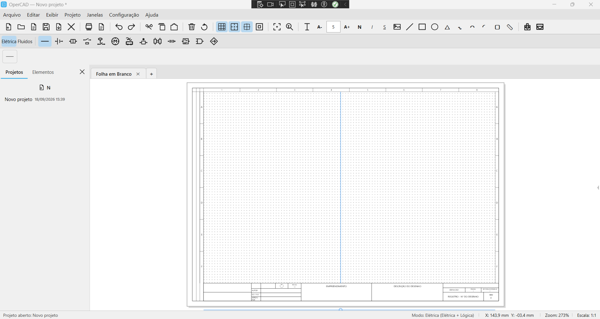
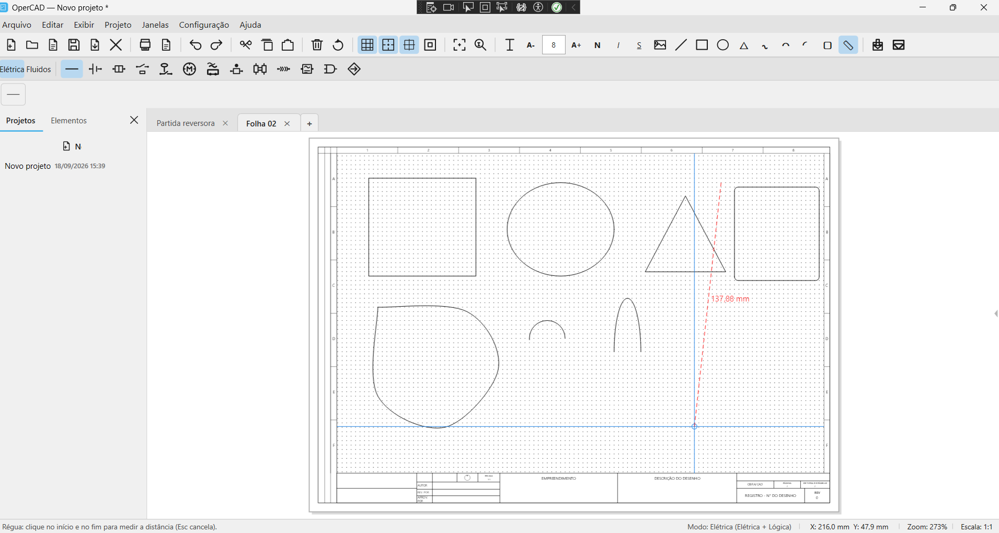
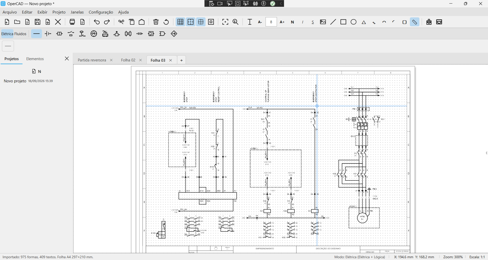
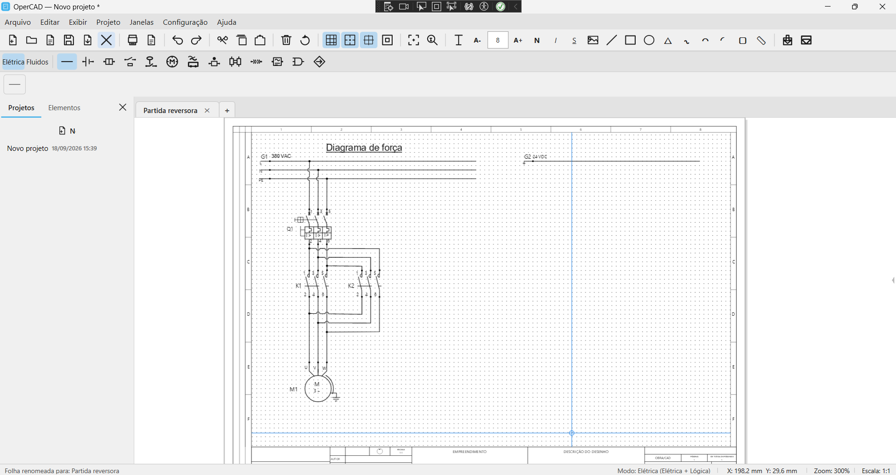

# OperCAD

Aplicativo desktop para criação e edição de esquemas técnicos. O OperCAD reúne ferramentas de desenho, biblioteca de elementos e recursos para importar e exportar projetos.

## Capturas de tela



Tela principal do aplicativo.



Ferramentas de desenho livre e formas geométricas.



Exemplo de desenho técnico importado de PDF.



Edição de um esquema no ambiente de desenho.

## Download

Baixe a versão mais recente em [Releases](https://github.com/LDElectric/OperCAD/releases/latest). A versão beta de testes é identificada como **1.0**. A publicação para Windows x64 é distribuída como um executável autocontido. Salve `OperCAD.exe` em uma pasta gravável e execute-o; na primeira inicialização, os recursos padrão são extraídos ao lado do executável.

Os projetos e as configurações do usuário ficam na pasta `data` criada junto ao aplicativo. Não remova nem altere os recursos extraídos, como `elements_opcad`, `titleblocks` e `template.json`.

## Compilação

Requisitos: Windows e .NET 10 SDK.

```powershell
dotnet build OperCAD.slnx
```

Para iniciar o aplicativo durante o desenvolvimento:

```powershell
dotnet run --project src/OperCAD.App/OperCAD.App.csproj
```

## Estrutura

- `src/OperCAD.App`: inicialização e publicação do executável Windows.
- `src/OperCAD.Application`: serviços de aplicação, importação/exportação e recursos padrão.
- `src/OperCAD.Core`: modelos e regras centrais do domínio.
- `src/OperCAD.Drawing`: renderização e regras de desenho.
- `src/OperCAD.UI`: interface WPF.
- `Prints`: capturas de tela usadas nesta página.

## Dependências

As dependências externas são declaradas nos arquivos `.csproj` e restauradas pelo NuGet durante a compilação. Entre as dependências diretas estão PdfPig (`UglyToad.PdfPig`), SkiaSharp e CommunityToolkit.Mvvm. Não é necessário versionar os pacotes restaurados nem os artefatos de build.

## Uso e atribuição

Os termos abaixo reproduzem a declaração apresentada na aba **Licença** da janela “Sobre o OperCAD”:

> Este software é disponibilizado como código aberto para fins de avaliação, teste e desenvolvimento colaborativo, com a finalidade de promover transparência técnica e revisão da solução.
>
> A autoria do desenvolvimento desta aplicação deve ser respeitada. Qualquer cópia, adaptação, fork, distribuição, reutilização parcial ou comercialização da solução deve manter a identificação da origem e os devidos créditos ao projeto original.
>
> Não é permitido remover os elementos de autoria, apresentar versões derivadas como se fossem originais, ou utilizar a aplicação para fins comerciais sem o reconhecimento adequado da origem e da criação intelectual do software.
>
> A utilização deste software em contextos comerciais, institucionais ou de distribuição deve respeitar os direitos sobre a criação e a identidade da solução, preservando a origem e a devida atribuição do desenvolvimento.

Este texto é a declaração de uso e atribuição do projeto; não identifica uma licença padronizada. Nenhum arquivo `LICENSE` foi adicionado para não conceder direitos diferentes dos descritos no aplicativo.
